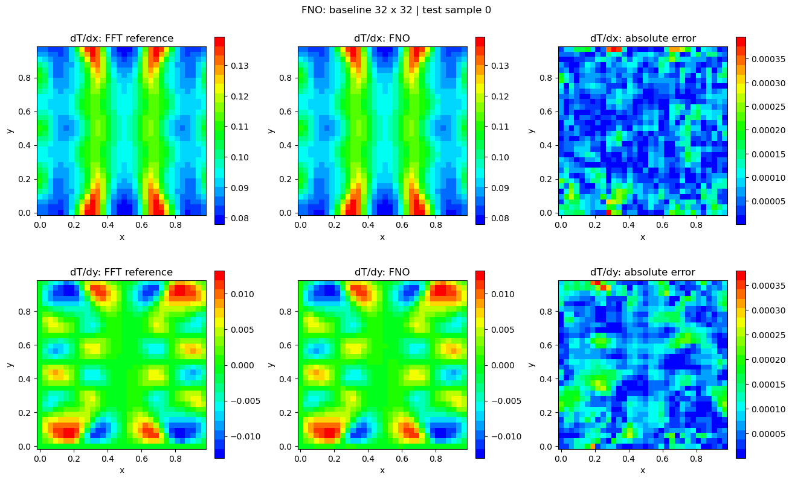
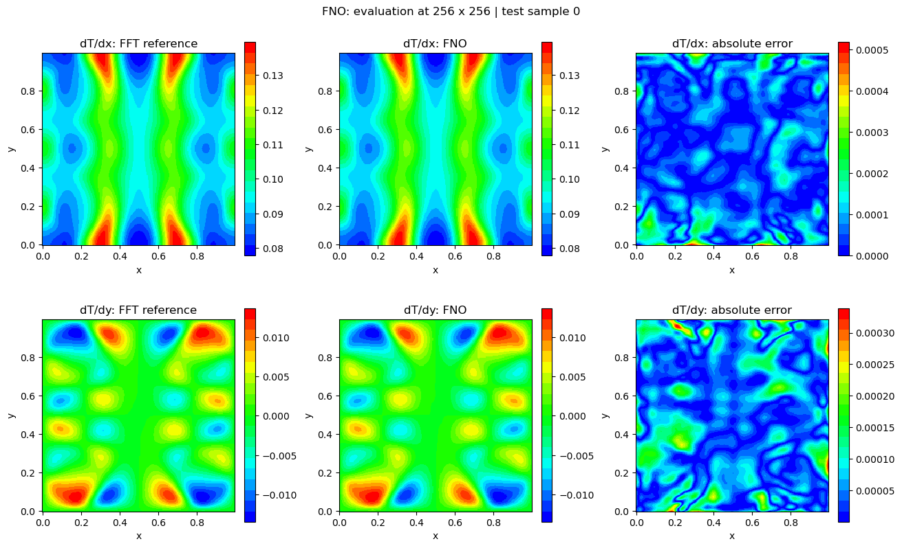
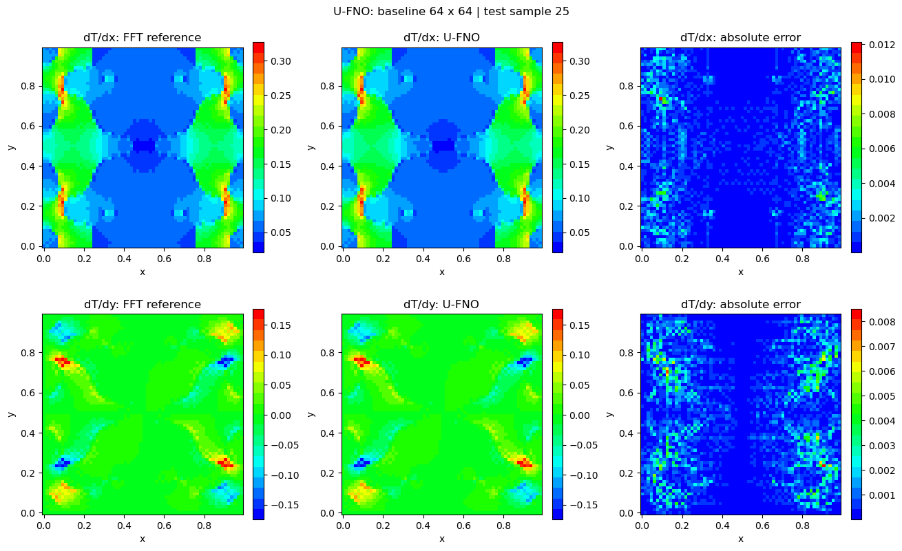
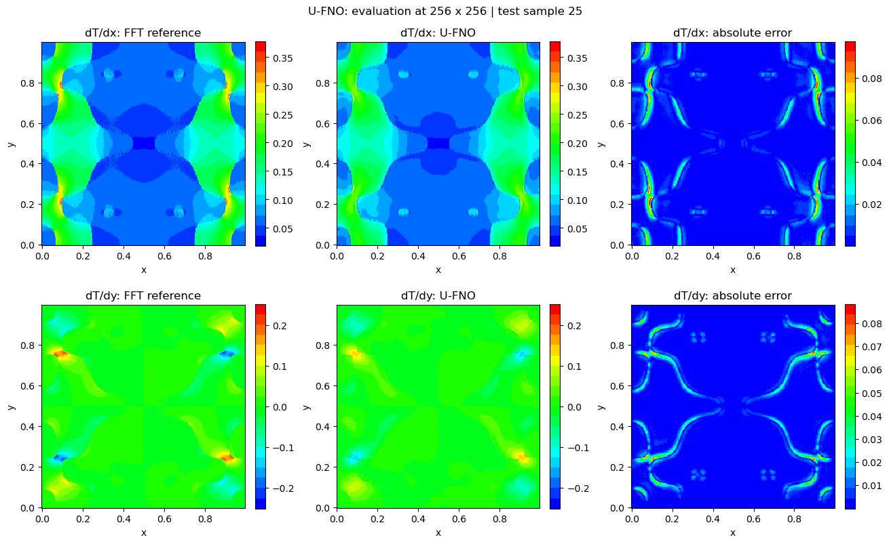
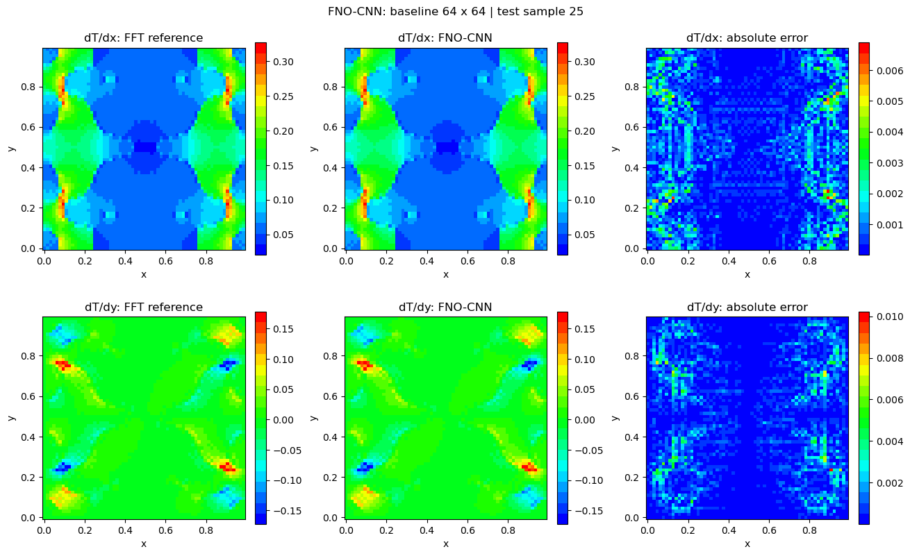
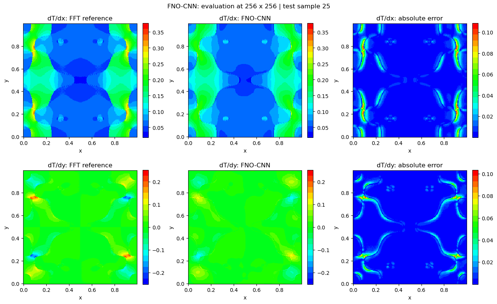

# Fourier Neural Operators for Thermal Homogenization

Research implementations of **Fourier Neural Operators (FNOs)** and two architecture extensions for predicting the local temperature-gradient field of heterogeneous two-dimensional materials. The numerical reference is a periodic FFT thermal solver in [fft_thermal_solver.py](fft_thermal_solver.py), implemented with JAX.

## Models

| Notebook | Model | Distinctive component |
| --- | --- | --- |
| [Baseline-FNO.ipynb](Baseline-FNO.ipynb) | FNO | Spectral convolution blocks |
| [Baseline-UFNO.ipynb](Baseline-UFNO.ipynb) | U-FNO | Additional U-Net branches within FNO blocks |
| [Baseline-FNO-CNN.ipynb](Baseline-FNO-CNN.ipynb) | FNO-CNN | Local convolutional feature processing |

The notebooks use **JAX, Equinox, Optax, NumPy**, and Matplotlib. Heterogeneous conductivity fields are generated from stored Fourier-coefficient parameters, and predicted gradients are compared with the FFT solution.

## Saved evaluation results

The following metrics were printed by **the committed, previously executed notebooks after loading existing model checkpoints**. These are different saved configurations and test-set sizes, **not a controlled head-to-head benchmark**, and the checkpoint files themselves are not included here.

| Model | Native grid | Test samples | Mean gradient relative L2 error, native grid | Error at 256×256 (zero-shot) |
| --- | ---: | ---: | ---: | ---: |
| FNO | 32×32 | 16 | 0.9110% | 0.3246% |
| U-FNO | 64×64 | 96 | 0.4185% | 3.5545% |
| FNO-CNN | 64×64 | 96 | 0.3930% | 5.1513% |

The native-grid and super-resolution results are directly transcribed from the notebook outputs. The FNO row uses a different native resolution and smaller test set, so **do not rank the architectures using this table**. The notebooks report `load_weights=True` and skip retraining. Further provenance is given in [results/saved_evaluations.md](results/saved_evaluations.md).

## Prediction visualizations

These are **actual images saved in the executed notebooks**, not regenerated demonstrations.

### FNO

### U-FNO

### FNO-CNN

## Reproducing the experiments

1. Install Python with JAX, Equinox, Optax, NumPy and Matplotlib.
2. Keep `coeff_vec.npy`, `phi0.npy`, `l_data.npy`, `m_data.npy` and `FFT_color_coding.txt` in the repository root alongside `fft_thermal_solver.py`.
3. Open the target notebook and adjust `n`, `n_train`, `n_test`, and model settings. Set `train_model=True` to run a new experiment; using `load_weights=True` requires a compatible `.eqx` checkpoint that is **not committed**.
4. Compare the predicted gradient against the iterative FFT reference, then inspect the zero-shot 256×256 evaluations.

**Reproducibility note:** the public notebooks contain saved results, but the checkpoints required to reproduce those exact loaded-weight evaluations are not currently tracked. No new model training or validation was performed when preparing the documentation.

## Related numerical project

[FFT homogenization / coupled thermo-mechanical solver](https://github.com/thanhnd034/fft-homogenization).
